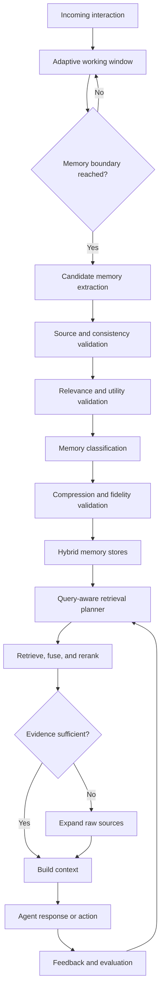

# FidelityMem

## Recall-Constrained Adaptive Hybrid Memory for LLM Agents

**Working name:** FidelityMem  
**System category:** Adaptive hybrid memory infrastructure for LLM agents and multi-agent systems  
**Primary goal:** Preserve useful evidence and retrieval recall while reducing context size, latency, token consumption, and memory noise.

---

## 1. Executive summary

FidelityMem is a proposed Python memory layer for LLM applications. It combines a query-adaptive working-memory window with semantic, episodic, procedural, relational, and archival memory. It decides what to keep in active context, what to move into long-term memory, how aggressively each memory can be compressed, and when the original evidence must be restored.

The main research proposition is not simply to combine multiple memory stores. Existing research already covers hybrid memory, adaptive retrieval, provenance, graph memory, and compression. FidelityMem's defensible contribution would be a **recall-constrained controller** that dynamically selects window size, memory routes, retrieval depth, and compression level while enforcing measurable evidence-preservation constraints.

The proposed claim is:

> FidelityMem minimizes storage, context size, retrieval latency, and token cost while maintaining a configured lower bound on evidence recall and an upper bound on contradictions.

This system could serve conversational agents, multi-agent code review, security investigation agents, customer support, self-healing data pipelines, developer assistants, and long-running enterprise workflows.

---

## 2. Starting use case: multi-agent code review

A multi-agent code-review system assigns focused review responsibilities to several agents and combines their findings into one review.

Typical agents include:

| Agent | Responsibility |
| --- | --- |
| Correctness agent | Logic errors, edge cases, exception handling, and unintended behavior |
| Security agent | Authorization, injection risks, secrets, unsafe input handling, and data exposure |
| Performance agent | Inefficient queries, loops, allocations, network calls, and concurrency problems |
| Architecture agent | Consistency with repository patterns and service boundaries |
| Testing agent | Missing coverage, weak assertions, and regression scenarios |
| Coordinator | Delegation, deduplication, validation, severity ranking, and final review construction |

The normal workflow is:

1. A pull request is opened or updated.
2. The system collects the diff, surrounding code, related tests, repository guidelines, and deterministic tool output.
3. Specialized agents review the change in parallel.
4. Findings are represented in a structured schema containing the file, line, severity, evidence, explanation, and suggested correction.
5. A verifier checks whether each finding is supported by the code.
6. The coordinator removes duplicate and unsupported comments.
7. The system posts one consolidated pull-request review.

A practical implementation stack includes Python, an orchestration layer such as LangGraph or a smaller `asyncio` coordinator, an LLM API, Pydantic, GitHub Actions, the GitHub API, Docker, and deterministic tools such as Ruff, mypy, pytest, Semgrep, and dependency scanners.

### Runtime test generation

The testing agent can generate a focused test when it finds a potential defect that existing tests do not cover. Test generation should be conditional rather than automatic for every review.

The preferred sequence is:

1. Identify a concrete suspected defect.
2. Check whether an existing test already covers it.
3. Generate a targeted regression test in an isolated environment.
4. Run the test against the proposed change.
5. Use the result as evidence for or against the finding.
6. Save the test temporarily as a CI artifact or suggest it as a pull-request patch.
7. Add it permanently to the repository only after developer review.

FidelityMem would improve this system by remembering repository conventions, earlier accepted and rejected findings, recurring defects, prior test outcomes, architecture decisions, and useful repair patterns.

---

## 3. Problem statement

LLM agents have limited context windows, while real applications accumulate long histories. Supplying the entire history is expensive and can reduce answer quality because relevant evidence competes with irrelevant material. Fixed sliding windows are efficient but discard older information without considering whether it remains important. Vector retrieval helps but can miss exact, temporal, relational, or multi-hop evidence.

Compression reduces context and storage requirements but can remove entities, dates, quantities, negations, causal relationships, or supporting evidence. A system may retrieve the correct compressed memory record while the information required to answer the question has already been removed.

The engineering problem is therefore not merely storing more information. The system must determine:

- What should become memory.
- Which type of memory should store it.
- How long it should remain in active context.
- How aggressively it can be compressed.
- Which retrieval strategy is appropriate for the current request.
- Whether the returned evidence is complete, current, and trustworthy.
- When the raw source must be restored.

---

## 4. Proposed architecture



### 4.1 Memory types

| Memory type | Stored information | Example |
| --- | --- | --- |
| Working memory | Current task state, recent messages, and active tool results | Current debugging hypothesis |
| Semantic memory | Stable facts and concepts | The repository uses PostgreSQL |
| Episodic memory | Events, actions, contexts, and outcomes | A deployment failed after a schema change |
| Procedural memory | Reusable instructions and successful workflows | Validate migrations before deployment |
| Relational memory | Entities and their relationships | Service A depends on database B |
| Archival memory | Complete, immutable source material | Original conversation or execution trace |

A single event can produce several memories. A failed deployment can remain an episode, produce a semantic fact about the root cause, and generate a procedural rule for future deployments.

---

## 5. Adaptive working-memory window

FidelityMem would use a non-fixed window. Each message or event receives a retention score based on the current request:

\[
R(m,q) =
w_s S_{semantic}
+w_r S_{recency}
+w_i S_{importance}
+w_t S_{task\ continuity}
+w_c S_{confidence}
+w_u S_{utility}
\]

The active window can grow when older messages remain important to an unresolved task and shrink after a task ends or the topic changes.

Possible boundary triggers include:

- Token-budget pressure.
- Topic, intent, or entity changes.
- Task completion.
- A meaningful decision or tool result.
- Inactivity.
- A change in source authority.
- Detection of a reusable experience.

Memories should be extracted asynchronously when a boundary is detected. The system should not wait until information has already become irrelevant or has fallen out of context.

---

## 6. Three-stage memory validation

The proposed admission and compression process contains three explicit validation stages.

### Stage 1: source and consistency validation

- Attach the original source, timestamp, tenant, and evidence pointer.
- Compare the candidate with an authoritative source when one exists.
- Check for contradictions with existing memories.
- Track versions and validity intervals.
- Assign calibrated confidence.
- Reject instructions embedded in untrusted content from becoming procedural memory.

Some memories, such as user preferences, may not have an external source of truth. In those cases, the original interaction and its provenance are the source.

### Stage 2: relevance and utility validation

Do not rely only on embedding similarity. Evaluate:

- Semantic similarity.
- Lexical and entity overlap.
- Temporal relevance.
- Graph proximity.
- Task applicability.
- Past retrieval utility.
- Authority and confidence.
- Whether the information changes a likely action or answer.

### Stage 3: post-compression fidelity validation

After compression, verify that the representation preserves:

- Important entities.
- Dates and ordering.
- Quantities and identifiers.
- Negations and constraints.
- Causal relationships.
- Source attribution.
- Evidence required for expected queries.

If validation fails, retry at a lower compression ratio or retain the raw representation.

These checks reduce incorrect memories but cannot guarantee that no incorrect memory will ever be stored. The system should express uncertainty, preserve provenance, and support correction and rollback.

---

## 7. Reversible compression

Compressed memory should be treated as an efficient index rather than the final authority. FidelityMem should preserve both the compressed representation and a pointer to the immutable source.

```json
{
  "memory_id": "mem_1042",
  "raw_source": "object://episodes/1042.json",
  "compressed_text": "Deployment failed because migration 18 removed a required column.",
  "memory_types": ["episodic", "procedural"],
  "entities": ["deployment-382", "migration-18"],
  "valid_from": "2026-10-01T12:00:00Z",
  "valid_to": null,
  "confidence": 0.94,
  "source_version": 3,
  "compression_version": 2
}
```

The system searches compact representations first. It expands the raw source when:

- Confidence is low.
- Exact values or quotations are required.
- Retrieved memories conflict.
- Evidence appears incomplete.
- The task is high impact.
- Multi-hop reasoning requires relationships removed by compression.

Preserving raw evidence also allows historical memories to be recompressed when better models or policies become available.

---

## 8. Query-aware hybrid retrieval

For each request, the retrieval planner decides which memory types to search, how deeply to search them, and how much context each type receives.

Candidate retrieval may include:

- Recent active context.
- Dense vector similarity.
- BM25 or full-text search.
- SQL and metadata filters.
- Temporal range queries.
- Knowledge-graph traversal.
- Successful past episodes.
- Procedural rules.

A general ranking function is:

\[
Score(m,q) =
w_sS_{semantic}
+w_kS_{keyword}
+w_rS_{recency}
+w_uS_{utility}
+w_gS_{graph}
+w_aS_{authority}
\]

The weights, retrieval depths, and token allocations can change by request type:

| Request type | Preferred strategy |
| --- | --- |
| Simple factual question | Semantic and lexical retrieval, high compression |
| Temporal question | Episodic timeline, time-aware retrieval |
| Multi-hop question | Graph expansion and related episodes |
| Exact numerical task | Raw evidence with minimal compression |
| Security investigation | Entities, graph relationships, incidents, and authoritative logs |
| Code review | Repository facts, related changes, earlier findings, tests, and procedures |

---

## 9. Configurable memory budget

A user-selected percentage must have a precise meaning. It could otherwise refer to context use, candidate retention, or compression ratio.

A clearer interface is constraint based:

```python
policy = MemoryPolicy(
    max_context_tokens=4000,
    minimum_recall_retention=0.95,
    maximum_contradiction_rate=0.01,
    latency_budget_ms=300,
    mode="balanced",
)
```

Possible modes are:

| Mode | Behavior |
| --- | --- |
| Fast | Low latency, aggressive compression, fewer sources |
| Balanced | Moderate recall, latency, and cost |
| High recall | Deeper retrieval, more verification, and more raw-source expansion |

The controller should determine the actual percentage assigned to each memory type.

---

## 10. Self-optimization

Self-optimization should mean controlled policy improvement rather than unpredictable modification after every request.

The system can learn from:

- Whether retrieved evidence was used.
- Whether an answer was correct.
- Whether a developer accepted or rejected a code-review finding.
- Retrieval precision and recall.
- Task success.
- Raw-source expansion frequency.
- Latency, token usage, and cost.
- Contradiction and stale-memory incidents.

The controller can adjust:

- Working-window boundaries.
- Retrieval source selection.
- Top-*k* for each source.
- Ranking weights.
- Compression ratios.
- Context allocation.
- Memory expiration and consolidation policies.

Potential optimization approaches include contextual bandits, Bayesian optimization, policy learning, or guarded offline search. Policy changes should be evaluated on a held-out set and rolled back when they cause regression.

---

## 11. Formal objective

Let \(\pi\) represent the memory policy. FidelityMem can minimize operational cost:

\[
\min_{\pi}
\left(
\alpha \cdot Storage
+\beta \cdot Latency
+\gamma \cdot TokenCost
+\delta \cdot RetrievalNoise
\right)
\]

subject to:

\[
Recall_{compressed}@K
\geq
\rho \cdot Recall_{raw}@K
\]

\[
ContradictionRate \leq \epsilon
\]

\[
UnsupportedClaimRate \leq \eta
\]

For example, \(\rho=0.95\) requires the compressed system to preserve at least 95% of raw-memory retrieval recall.

---

## 12. Use cases

### Multi-agent code review

Remember architecture decisions, recurring defects, accepted and rejected findings, repository conventions, generated regression tests, and developer feedback.

### Security investigation

Connect current alerts with historical incidents, entities, evidence, analyst decisions, playbooks, and previous false positives. Provenance and temporal validity are essential.

### Self-healing data pipelines

Associate current failures with earlier incidents, schemas, repair actions, logs, and successful recovery patterns.

### Customer support

Combine the active conversation, customer history, product documentation, known incidents, and earlier resolutions.

### Developer assistants

Remember repository structure, technical decisions, debugging attempts, build failures, and preferred workflows across sessions.

### Enterprise knowledge agents

Retrieve from documents, databases, tickets, conversations, and organizational graphs while preserving access controls and provenance.

### Personal assistants

Maintain preferences, commitments, recurring tasks, relationships, and evolving facts without treating outdated information as current.

---

## 13. Scalability design

The system can scale if memory processing is separated into online and background paths.

### Online path

- Classify the request.
- Read active state.
- Search selected memory stores in parallel.
- Fuse and rerank results.
- Validate evidence sufficiency.
- Expand raw evidence when required.
- Build the bounded context.

### Background path

- Extract candidate memories.
- Generate embeddings.
- Consolidate repeated memories.
- Detect contradictions.
- Compress and validate.
- Update graphs and indexes.
- Re-evaluate retrieval policies.
- Archive low-use raw histories.

### Suggested infrastructure

- FastAPI for service interfaces.
- PostgreSQL for structured memories, metadata, versions, and policies.
- pgvector or a vector database for dense retrieval.
- Redis for active memory, caching, and short-lived state.
- OpenSearch or PostgreSQL full-text search for lexical retrieval.
- A graph database or relational edge tables for relationship retrieval.
- Object storage for immutable raw episodes.
- Kafka or a job queue for asynchronous extraction and consolidation.
- OpenTelemetry for traces, latency, failures, and cost.

### Scale controls

- Partition by tenant, user, project, repository, and agent.
- Apply access controls before retrieval results enter context.
- Filter by metadata before expensive semantic search.
- Cache frequent query plans and stable results.
- Deduplicate and version memories.
- Expire low-value derived representations while retaining governed raw sources.
- Use batch background compression and embedding.
- Monitor P50 and P95 latency, write throughput, index size, and cost.

---

## 14. Relationship to existing research

The broad idea overlaps significantly with current research. FidelityMem should not claim that adaptive windows, hybrid memory, compression, provenance, or query-aware retrieval are individually new.

| Work | Relevant contribution | Relationship to FidelityMem |
| --- | --- | --- |
| MemGPT | Hierarchical context management resembling RAM and disk | Foundation for active and archival tiers |
| HippoRAG | Knowledge graphs and Personalized PageRank | Foundation for associative and multi-hop retrieval |
| QueryLink | Coherent sliding-window chunking and multi-grained query-memory alignment | Strong overlap with adaptive chunking and retrieval |
| AdaMem | Working, episodic, persona, and graph memories with question-conditioned routing | Strong overlap with hybrid memory routing |
| Synapse | Episodic-semantic graph, embeddings, graph activation, and temporal decay | Strong overlap with hybrid graph retrieval |
| MemORAI | Selective filtering, dual-layer compression, provenance, and query-adaptive PageRank | Strong overlap with validation, compression, and provenance |
| R³Mem | Reversible context compression and raw-data reconstruction | Related to reversible compression |
| EvolveMem | Joint evolution of stored memory and retrieval configuration | Strong overlap with self-optimization |
| MemRL | Semantic filtering followed by utility learning from feedback | Related to learned retrieval utility |
| Agent Zero Memory | Parallel episodic, graph, and semantic stores with provenance and citation-locked answers | Strong overlap with verified hybrid retrieval |

The combined high-level architecture is therefore incremental. A stronger research contribution is the **formal recall constraint**, the joint controller, the validation protocol, and a careful accuracy-cost-latency evaluation at increasing scale.

---

## 15. Evaluation methodology

### 15.1 Baselines

Every comparison should use the same source histories, LLM, embedding model, reranker, context-token budget, and retrieval depth where applicable.

Recommended baselines:

1. Full context, where feasible.
2. Fixed sliding window.
3. Conversation summarization.
4. BM25 retrieval.
5. Dense vector retrieval.
6. BM25 and vector hybrid retrieval.
7. Fixed-window hybrid memory.
8. Graph-based memory.
9. Adaptive window without compression.
10. Adaptive window with compression.
11. Full FidelityMem with raw-source expansion and validation.

### 15.2 Benchmarks

| Benchmark | Evaluation focus |
| --- | --- |
| LoCoMo | Long conversations, temporal questions, and multi-hop reasoning |
| LongMemEval | Information extraction, multi-session reasoning, temporal reasoning, knowledge updates, and abstention |
| MemBench | Factual and reflective memory, recall, capacity, and temporal efficiency |
| Memora | Remembering, reasoning, recommendations, and obsolete-memory handling |
| RealMem | Long-running projects and evolving goals |
| DolphinBench | Memory-dependent agent actions, accuracy, cost, and latency |

### 15.3 Scale levels

Use the same evidence and questions while progressively adding realistic distractors.

| Scale | Suggested history size |
| --- | ---: |
| Small | 1,000 memories or 10K tokens |
| Medium | 10,000 memories or 100K tokens |
| Large | 100,000 memories or 1M tokens |
| Very large | 1 million memories or 10M+ tokens |

Evaluate several retrieval depths, such as \(K \in \{1,3,5,10,20,50\}\), but report the associated token cost and latency.

### 15.4 Retrieval metrics

For a query \(q\), let \(G_q\) be the gold evidence memories and \(R_q^K\) the top-*K* retrieved memories:

\[
Recall@K(q)=\frac{|G_q \cap R_q^K|}{|G_q|}
\]

Measure:

- Recall@K.
- Precision@K.
- MRR.
- nDCG@K.
- Complete evidence-set recall.
- Duplicate retrieval rate.

### 15.5 Compression metrics

Calculate recall on raw and compressed indexes:

\[
RecallRetention@K =
\frac{Recall_{compressed}@K}{Recall_{raw}@K}
\]

Also report:

- Compression ratio.
- Evidence-span preservation.
- Entity preservation.
- Numerical and temporal preservation.
- Negation preservation.
- Source entailment.
- Contradiction rate.
- Raw-source expansion rate.

Retrieving the correct memory identifier is insufficient if compression removed the fact required by the question.

### 15.6 Downstream and operational metrics

- Exact match or F1.
- Answer accuracy.
- Multi-hop reasoning accuracy.
- Correct abstention.
- Task success.
- Unsupported-claim rate.
- Outdated-memory usage.
- Indexing throughput.
- P50 and P95 retrieval latency.
- Storage usage.
- Tokens and cost per successful query.
- Background maintenance cost.

### 15.7 Ablation studies

Evaluate the complete system and remove one component at a time:

```text
Full FidelityMem
− adaptive window
− source validation
− semantic and utility validation
− post-compression validation
− raw-source expansion
− graph memory
− learned retrieval weights
```

This identifies which component creates each improvement.

### 15.8 Experimental controls

- Use identical histories and evidence annotations.
- Keep context budgets equal.
- Fix random seeds.
- Repeat stochastic evaluations.
- Report confidence intervals.
- Separate tuning, validation, and final test sets.
- Do not tune on the final benchmark.
- Report failures and worst-case behavior, not only averages.

---

## 16. Research questions

1. Does an adaptive working-memory window improve Recall@K over a fixed window?
2. How much compression is possible before evidence recall materially declines?
3. Does three-stage validation reduce incorrect, contradictory, and obsolete memories?
4. Does raw-source expansion recover accuracy lost during compression?
5. Does query-aware routing remain effective as histories grow from thousands to millions of memories?
6. Can the controller satisfy a recall-retention target while lowering latency, context tokens, and cost?
7. Which memory types provide the most value for factual, temporal, multi-hop, and procedural requests?
8. How well do policies learned on one benchmark or domain transfer to another?

The principal result should be a Pareto frontier comparing recall or task accuracy against compression, latency, storage, and cost.

---

## 17. Risks and limitations

- Compression can remove evidence even when semantic similarity remains high.
- Incorrect memories can propagate into later answers and actions.
- Highly similar past episodes can encourage an agent to repeat an earlier mistake.
- A source-of-truth check is unavailable for subjective preferences and some observations.
- Graph construction and maintenance may become expensive.
- Adaptive policies can overfit benchmark query distributions.
- Larger retrieval depth can improve recall while increasing noise and token cost.
- Memory isolation failures can expose information across tenants.
- Deletion, correction, retention, and user-requested forgetting require explicit lifecycle support.
- No practical system can guarantee zero relevance loss or zero incorrect memories.

The design should therefore use provenance, confidence, validity intervals, immutable raw evidence, access control, abstention, monitoring, and rollback.

---

## 18. Recommended development roadmap

### Phase 1: measurable retrieval baseline

- Implement raw episodic storage.
- Add BM25 and vector retrieval.
- Establish gold evidence IDs.
- Measure Recall@K, answer accuracy, latency, and cost.

### Phase 2: hybrid memory

- Add semantic, episodic, procedural, and relational schemas.
- Implement source metadata, namespaces, and tenant isolation.
- Add reciprocal-rank fusion and reranking.

### Phase 3: adaptive window and compression

- Detect topic and task boundaries.
- Add variable active-window retention.
- Preserve raw sources and create compressed representations.
- Measure recall before and after compression.

### Phase 4: validation

- Add source and contradiction checks.
- Add post-compression evidence probes.
- Implement fallback to lower compression or raw retrieval.

### Phase 5: policy optimization

- Log outcomes and retrieval utility.
- Learn request-specific routing and budgets.
- Add offline evaluation, policy versioning, rollback, and regression gates.

### Phase 6: scale evaluation

- Run LoCoMo, LongMemEval, MemBench, and at least one action-oriented benchmark.
- Add progressively larger distractor sets.
- Report accuracy, recall, compression, latency, storage, and cost together.

---

## 19. Naming options

### Recommended: FidelityMem

**Expanded description:** Recall-Constrained Adaptive Hybrid Memory for LLM Agents.

Why it works:

- Emphasizes preservation of evidence and meaning.
- Fits both a Python package and a research paper.
- Does not lock the system to one storage technology.
- Supports clear terminology such as fidelity score, fidelity gate, and fidelity budget.

Suggested paper title:

> **FidelityMem: Recall-Constrained Adaptive Hybrid Memory for LLM Agents**

Suggested package name:

```text
fidelitymem
```

### Other options

| Name | Meaning | Comment |
| --- | --- | --- |
| CARE-Mem | Constraint-Aware Recall-Efficient Memory | Strong academic acronym, but less distinctive |
| RecallMesh | Multiple memory sources joined through adaptive retrieval | Good infrastructure name |
| MemPilot | A controller that routes and budgets memory | Product-friendly but generic |
| ContextLoom | Weaves recent, semantic, episodic, and graph context | Memorable but less technical |
| RecallCore | Central retrieval and memory-control layer | Clear but likely difficult to protect |
| EvidenceMem | Memory centered on evidence and provenance | Accurate but narrow |

Names already showing obvious collisions in preliminary searches include VeraMem, RecallWeave, and RecallGuard. A complete package-registry, repository, domain, and trademark review is still required before public release.

---

## 20. Final positioning

FidelityMem should be presented as a memory-control and evaluation layer rather than another vector-memory wrapper.

Its value is the combination of:

- An adaptive working-memory window.
- Typed hybrid long-term memory.
- Three-stage memory validation.
- Provenance and temporal validity.
- Reversible compression with raw evidence fallback.
- Request-specific retrieval planning.
- Recall-constrained optimization.
- Evaluation across datasets, scales, latency, and cost.

The broad architecture is related to existing research. The strongest original contribution would be showing that one controller can maintain a configured evidence-recall target across different tasks and memory scales while automatically minimizing context size and operational cost.

---

## 21. Selected references

1. Packer et al. **MemGPT: Towards LLMs as Operating Systems.** 2023. <https://arxiv.org/abs/2310.08560>
2. Liu et al. **Lost in the Middle: How Language Models Use Long Contexts.** 2023. <https://arxiv.org/abs/2307.03172>
3. Gutiérrez et al. **HippoRAG: Neurobiologically Inspired Long-Term Memory for Large Language Models.** 2024. <https://arxiv.org/abs/2405.14831>
4. Wu et al. **LongMemEval: Benchmarking Chat Assistants on Long-Term Interactive Memory.** 2024. <https://arxiv.org/abs/2410.10813>
5. Wang et al. **R³Mem: Bridging Memory Retention and Retrieval via Reversible Compression.** ACL Findings 2025. <https://aclanthology.org/2025.findings-acl.235/>
6. Tan et al. **MemBench: Towards More Comprehensive Evaluation on the Memory of LLM-based Agents.** 2025. <https://arxiv.org/abs/2506.21605>
7. Hu et al. **QueryLink: Leveraging Query-Memory Alignment for Long-Term Reasoning in LLM Agents.** ACL Findings 2026. <https://aclanthology.org/2026.findings-acl.765/>
8. Jiang et al. **Synapse: Empowering LLM Agents with Episodic-Semantic Memory via Spreading Activation.** ACL Findings 2026. <https://aclanthology.org/2026.findings-acl.1108/>
9. Van et al. **MemORAI: Memory Organization and Retrieval via Adaptive Graph Intelligence for LLM Conversational Agents.** ACL Findings 2026. <https://aclanthology.org/2026.findings-acl.1408/>
10. Zhang et al. **MemRL: Self-Evolving Agents via Runtime Reinforcement Learning on Episodic Memory.** 2026. <https://arxiv.org/abs/2601.03192>
11. Liu et al. **EvolveMem: Self-Evolving Memory Architecture via AutoResearch for LLM Agents.** 2026. <https://arxiv.org/abs/2605.13941>
12. Uddin et al. **From Recall to Forgetting: Benchmarking Long-Term Memory for Personalized Agents.** ACL Findings 2026. <https://aclanthology.org/2026.findings-acl.1337/>
13. Xiong et al. **How Memory Management Impacts LLM Agents: An Empirical Study of Experience-Following Behavior.** ACL 2026. <https://aclanthology.org/2026.acl-long.27/>
14. **DolphinBench: Mapping the Pareto Frontier of Agent Memory.** 2026. <https://arxiv.org/abs/2609.24971>

---

*This document captures the complete design discussion and should be updated as the architecture, literature review, and experiments mature.*
